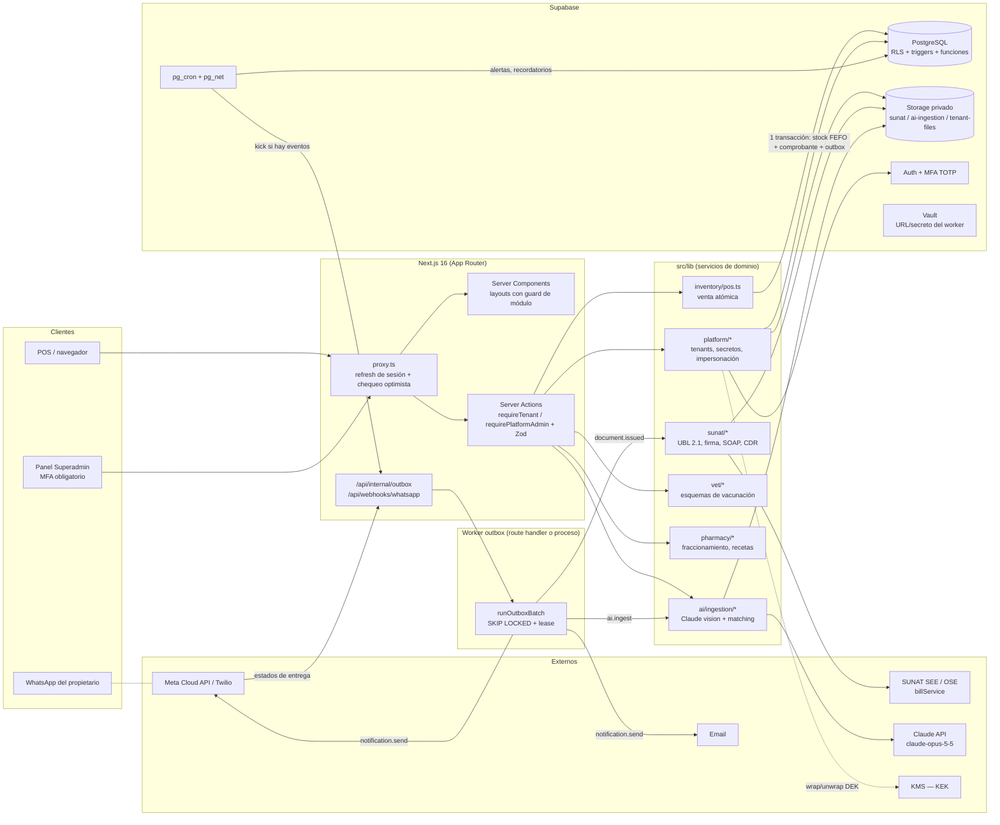
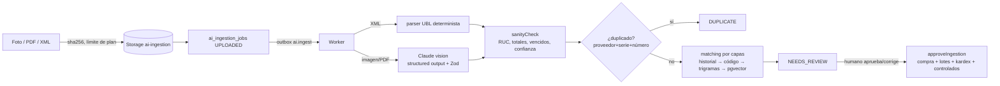

# Arquitectura — Nexo ERP

ERP + facturación electrónica SUNAT, SaaS multi-tenant, con un núcleo común y módulos verticales por rubro (agroveterinaria, veterinaria, botica/farmacia, comercio).

## 1. Vista general



## 2. Multi-tenancy

**Modelo:** base compartida, esquema compartido, `tenant_id` en cada fila de negocio, aislamiento por **RLS forzado** (`FORCE ROW LEVEL SECURITY`).

| Plano | Tablas | Acceso |
|---|---|---|
| Plataforma | `platform_admins`, `plans`, `subscriptions`, `tenant_modules`, `impersonation_sessions`, `tenant_exports`, `tenant_secrets`, `audit_logs` | Solo `platformDb()` (rol con BYPASSRLS) detrás de `requirePlatformAdmin()` |
| Tenant | todo lo demás | `runtimeDb()` (rol `app_runtime`, **NOBYPASSRLS**) siempre dentro de `withTenant()` |

**Contexto RLS.** `withTenant(ctx, fn)` abre una transacción y ejecuta `set_config('app.tenant_id', …, true)` (local a la transacción, seguro con PgBouncer en modo transaction). Las políticas usan `(SELECT app.current_tenant_id())` (se evalúa una vez por consulta). Para clientes Supabase directos (Realtime de notificaciones), el tenant sale de `app_metadata.tenant_id` del JWT y **se re-verifica la membresía** dentro de la función.

**Defensa en profundidad:**
- FK compuestas `(tenant_id, product_id) → products(tenant_id, id)` impiden referencias cruzadas entre tenants aunque falle la app.
- `tenant_secrets` tiene RLS activado **sin políticas** + `REVOKE`: ningún rol de tenant puede leerlo.
- `tenants` solo permite al runtime actualizar columnas de contacto (`GRANT UPDATE (col…)`); estado, plan y entorno SUNAT solo desde plataforma.
- Prueba automatizada: `tests/sql/integration.sql` y `tests/integration/pos.test.ts` verifican que un tenant no ve ni escribe datos de otro.

## 3. Sistema de módulos

`tenant_modules (tenant_id, module, enabled, config)` — `CORE` siempre activo. Dependencias en `MODULE_DEPENDENCIES` (`MAGISTRAL → PHARMACY`).

Los guards se aplican en tres capas, con una sola fuente de verdad (`getTenantContext()`, cacheado por request):

| Capa | Mecanismo |
|---|---|
| Rutas | `src/app/app/{vet,agro,pharmacy,purchases/ai}/layout.tsx` → `notFound()` si el módulo está inactivo |
| Server Actions | `requireTenant({ module, permission, mutation, branchId })` |
| Menú | `visibleNav(modules, can)` filtra `NAV` por módulo y permiso |

Al activar módulos por rubro en el alta: `AGROVET → AGRO + VETERINARY`, `VETERINARY → VETERINARY`, `PHARMACY → PHARMACY`, más los incluidos en el plan.

## 4. Seguridad

- **Secretos de tenant** (Clave SOL, `.pfx` + contraseña): *envelope encryption* AES-256-GCM. DEK aleatoria por secreto, envuelta por una KEK que vive en KMS (`KeyEncryptionKeyProvider`; localmente `LocalKekProvider` con `SECRETS_KEK_BASE64`). AAD = `tenant:{id}|kind:{kind}`: un ciphertext copiado a otro tenant no descifra. Solo los workers descifran, con caché en memoria de 10 min.
- **Certificado**: al subirlo se valida contraseña, vigencia y que el RUC del titular coincida; se guarda `certificate_expires_at` para alertas (30/15/7/1 días) y el dashboard.
- **Superadmin**: MFA obligatorio (`aal2`, verificado en `proxy.ts` y en `requirePlatformAdmin`). Acciones críticas (suspender, eliminar, credenciales SUNAT, impersonar, cambiar a producción) exigen **reautenticación** reciente (último factor verificado < 5 min, leído del claim `amr`).
- **Impersonación**: motivo ≥ 15 caracteres, TTL ≤ 60 min (CHECK en BD), solo lectura por defecto (escritura solo rol OWNER), banner visible, auditada en el log del **tenant**.
- **Auditoría**: `audit_logs` append-only (trigger bloquea UPDATE/DELETE) con **cadena de hash** por tenant (`prev_hash → hash`): cualquier alteración rompe la cadena. Campos sensibles se redactan antes de escribir.
- **Inmutabilidad fiscal**: trigger en `documents` bloquea cambios a campos fiscales y DELETE; `document_items`, `stock_movements`, `controlled_substance_log`, `sunat_submissions` son append-only.
- **Validación**: Zod en toda entrada de Server Actions; `ActionResult` nunca filtra errores internos.

## 5. Colas, reintentos, idempotencia (Outbox)

```mermaid
sequenceDiagram
  participant C as Caja (POS)
  participant A as Server Action
  participant DB as PostgreSQL
  participant CR as pg_cron
  participant W as Worker
  participant S as SUNAT/OSE

  C->>A: createSale(idempotencyKey)
  A->>DB: BEGIN; lock_timeout 3s
  A->>DB: app.consume_stock_fefo() por producto (orden product_id)
  A->>DB: app.next_document_number() (último lock)
  A->>DB: INSERT documents, items, lots, payments, outbox_events
  A->>DB: COMMIT
  A-->>C: B001-123 (sin esperar a SUNAT)
  CR->>W: POST /api/internal/outbox (si hay pendientes)
  W->>DB: app.claim_outbox() FOR UPDATE SKIP LOCKED + lease
  W->>W: firmar UNA vez (hash estable), guardar XML
  W->>S: sendBill(zip)
  S-->>W: CDR / fault
  W->>DB: sunat_submissions (+1 intento), estado del documento
  alt transitorio (0100, 0109, red…)
    W->>DB: FAILED, next_attempt_at = backoff exponencial
  else ya registrado (1033)
    W->>S: getStatusCdr → recuperar CDR
  end
```

- **Atomicidad**: venta, kardex, comprobante y evento outbox en una sola transacción; nada se envía a SUNAT dentro de la transacción.
- **Sin deadlocks**: todas las transacciones toman locks en el mismo orden (lotes por `product_id`, luego serie). Verificado con 30 carritos concurrentes en orden inverso.
- **Sin sobreventa**: `FOR UPDATE` solo sobre los lotes necesarios + `CHECK (stock >= 0)`. Verificado con 15 ventas concurrentes sobre stock 10.
- **Correlativo sin huecos**: `UPDATE document_series … RETURNING` al final de la transacción; si la venta falla, el rollback devuelve el número.
- **Idempotencia**: `documents.idempotency_key` único por tenant; carrera resuelta devolviendo la venta ganadora (`replayed: true`). Handlers del worker son idempotentes por estado; `outbox_events.dedupe_key` único.
- **Reintentos**: backoff exponencial con jitter (30 s → 6 h), `max_attempts`, cola muerta (`DEAD`) visible en el dashboard de plataforma. Lease (`locked_until`) recupera eventos de workers caídos.

## 6. Flujo de ingesta con IA



Baja confianza (< 0.75) nunca se auto-empareja; candidatos casi empatados van a revisión; las correcciones humanas quedan en `purchase_items` y alimentan el emparejamiento por historial del mismo proveedor.

## 7. Jobs programados (pg_cron, horas Lima)

| Job | Hora | Qué hace |
|---|---|---|
| `certificate-alerts` | 06:00 | Certificados que vencen en ≤ 30 días |
| `expiry-alerts` | 07:00 | Lotes a 90/60/30/15/7 días y vencidos (umbrales por tenant en `alert_rules`) |
| `low-stock-alerts` | 07:10 | Stock vendible ≤ mínimo (1 alerta por semana) |
| `vaccine-reminders` | 08:00 | 7/3/1/0 días antes; WhatsApp/email/in-app; deduplicado |
| `outbox-kick` | cada minuto | Despierta al worker solo si hay eventos pendientes |
| `outbox-cleanup` | diario | Purga eventos `DONE` > 30 días |

Todas las funciones de generación son set-based e idempotentes (`ON CONFLICT DO NOTHING` sobre `dedupe_key`) y toleran un día de atraso del cron.
